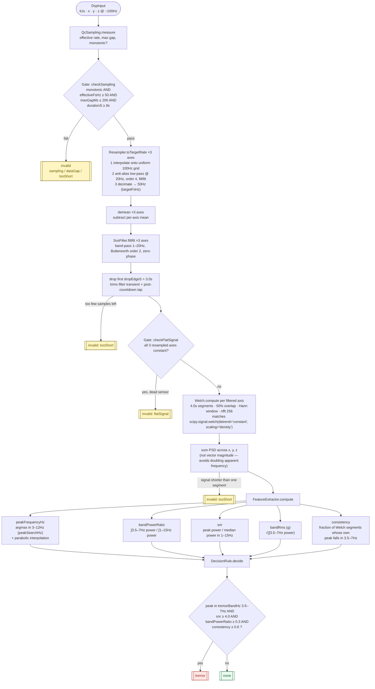

<div align="center">

# NuroPulse App

 

  

The codebase for NuroPulse's patient-facing mobile app, **a Parkinson’s companion app that screens for hand tremor** in under half a minute using just your phone’s sensors, **then connects you and your neurologist** with your medication and tremor history.

</div>

## Getting started

```bash
cp .env.example .env   # fill in your Supabase project URL and publishable (anon) key
flutter pub get
dart run build_runner build --delete-conflicting-outputs   # generates Freezed / JSON code
dart format .
flutter analyze
flutter test
flutter run                                                 # physical Android device
```

`.env` is git-ignored; `flutter_dotenv` loads it at startup (`core/environments/env.dart`) before `Supabase.initialize()` runs. Without it, the app fails fast with a clear error rather than silently misconfiguring Supabase.

## DSP pipeline

`lib/dsp/` is pure Dart (no Flutter, no I/O) and deterministic: the same `DspInput` always produces the same `TremorResult`. `TremorPipeline.analyze()` in [`lib/dsp/tremor_pipeline.dart`](./lib/dsp/tremor_pipeline.dart) orchestrates the stages below in order; any gate failure short-circuits straight to an `invalid` result instead of running the remaining stages.

All thresholds, filter coefficients, and band edges come from [`assets/config/dsp_config.json`](./assets/config/dsp_config.json) (`DspConfig`).



## Dependencies

| Package                                  | Version           | Purpose                                              |
| ---------------------------------------- | ----------------- | ---------------------------------------------------- |
| `flutter_bloc`                           | ^9.1.1            | State management (Cubit, no Bloc events)             |
| `freezed` / `freezed_annotation`         | 3.2.5 / ^3.1.0    | Immutable Cubit states & data models                 |
| `json_serializable` / `json_annotation`  | ^6.14.1 / ^4.12.0 | JSON (de)serialization for models                    |
| `go_router`                              | ^18.0.1           | Declarative routing (`services/router_service.dart`) |
| `hive_ce` / `hive_ce_flutter`            | ^2.20.1 / ^2.4.0  | Local storage for measurements & settings            |
| `sensors_plus`                           | ^7.1.1            | Accelerometer sampling for the tremor check          |
| `fftea`                                  | ^1.5.0+1          | FFT for the on-device DSP pipeline                   |
| `fl_chart`                               | ^1.2.0            | Frequency-spectrum chart on the detail screen        |
| `flutter_svg`                            | ^2.3.0            | SVG icons/logo rendering                             |
| `lottie`                                 | ^3.6.1            | Pulse animation on the processing screen             |
| `google_nav_bar`                         | ^5.0.7            | Bottom navigation bar for the home shell             |
| `wakelock_plus`                          | ^1.8.1            | Keeps the screen on while recording                  |
| `device_info_plus` / `package_info_plus` | ^13.3.0 / ^10.2.2 | Device & app metadata sent with a measurement        |
| `path_provider`                          | ^2.1.6            | Filesystem paths for local storage                   |
| `uuid`                                   | ^4.6.0            | Client-generated measurement IDs                     |
| `share_plus`                             | ^13.3.1           | Sharing results/history                              |
| `logger`                                 | ^2.8.0            | Wrapped by `services/logger_service.dart`            |
| `supabase_flutter`                       | ^2.18.3           | Backend client — auth & data, not yet wired past init |
| `flutter_dotenv`                         | ^6.0.1            | Loads `.env` for `core/environments/` (Supabase URL/anon key) |
| `flutter_secure_storage`                 | planned           | Auth session storage, once implemented               |

Dev-only: `flutter_lints`, `build_runner`, `bloc_test`, `mocktail`, `flutter_launcher_icons`.
